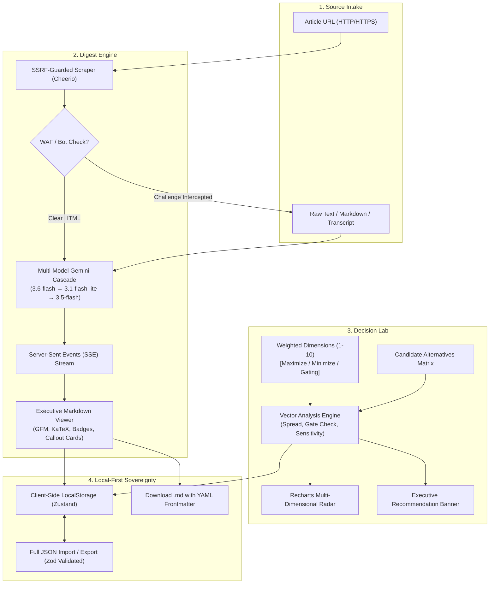

<div align="center">

# ⚡ Decilume OS
### The High-Performance Personal Executive Command Center

*Deci* (Decision) + *Lume* (Illuminate / Light) — Shedding light on complex decisions and dense technical knowledge.

[](https://nextjs.org/)
[](https://react.dev/)
[](https://www.typescriptlang.org/)
[](https://bun.sh/)
[](https://tailwindcss.com/)
[](https://ai.google.dev/)
[](https://www.docker.com/)
[](LICENSE)

<br />

**Decilume OS** is an executive-grade personal workstation built to eradicate cognitive friction. It pairs automated web article extraction and real-time LLM intelligence streaming with quantitative, multi-criteria mathematical decision modeling and interactive trade-off visualizations.

```
       ┌────────────────────────────────────────────────────────┐
       │                      DECILUME OS                       │
       ├──────────────────────────┬─────────────────────────────┤
       │      DIGEST ENGINE       │        DECISION LAB         │
       │  URL / Text Ingestion    │   MCDA Multi-Criteria       │
       │  Cheerio HTML Scraper    │   Vector Scoring & Gating   │
       │  Gemini Streaming SSE    │   Recharts Radar Trade-Offs │
       │  Executive Markdown      │   Sensitivity Analysis      │
       └──────────────────────────┴─────────────────────────────┘
                                  │
                      LOCAL-FIRST PERSISTENCE
               (Zustand + LocalStorage + JSON Export)
```

</div>

---

## 📑 Table of Contents

- [1. Executive Summary & Problem Space](#1-executive-summary--problem-space)
- [2. Who It's For](#2-who-its-for)
- [3. Core Subsystems & What It Does](#3-core-subsystems--what-it-does)
  - [Subsystem A: The Digest Engine](#subsystem-a-the-digest-engine)
  - [Subsystem B: The Decision Lab](#subsystem-b-the-decision-lab)
  - [Subsystem C: Local-First Architecture & Data Sovereignty](#subsystem-c-local-first-architecture--data-sovereignty)
- [4. High-Level Architecture & Technical Stack](#4-high-level-architecture--technical-stack)
- [5. Getting Started & How to Run](#5-getting-started--how-to-run)
  - [Prerequisites](#prerequisites)
  - [Local Development (Native Bun)](#local-development-native-bun)
  - [Production Docker Deployment](#production-docker-deployment)
  - [Hot-Reloading Docker Dev Container](#hot-reloading-docker-dev-container)
  - [Cloud Deployment (Vercel & CI/CD)](#cloud-deployment-vercel--cicd)
  - [Environment Variables](#environment-variables)
- [6. Project Blueprint & Directory Structure](#6-project-blueprint--directory-structure)
- [7. How I Built Decilume OS With AI (The Project Document & Engineering Log)](#7-how-i-built-decilume-os-with-ai-the-project-document--engineering-log)
  - [7.1 Philosophy & Human-AI Co-Engineering Workflow](#71-philosophy--human-ai-co-engineering-workflow)
  - [7.2 Milestone 1: Spec-First Scaffolding & Container Setup](#72-milestone-1-spec-first-scaffolding--container-setup)
  - [7.3 Battle Story 1: Docker Compose Env Variable Collision](#73-battle-story-1-docker-compose-env-variable-collision)
  - [7.4 Battle Story 2: The Upstream Gemini Deprecation & 503 Traffic Shock](#74-battle-story-2-the-upstream-gemini-deprecation--503-traffic-shock)
  - [7.5 Battle Story 3: Anti-Bot WAF Interception (IEEE CloudFront Challenge)](#75-battle-story-3-anti-bot-waf-interception-ieee-cloudfront-challenge)
  - [7.6 Battle Story 4: Security Hardening & SSRF Defense In Depth](#76-battle-story-4-security-hardening--ssrf-defense-in-depth)
  - [7.7 Battle Story 5: Crafting the Executive Markdown Design System](#77-battle-story-5-crafting-the-executive-markdown-design-system)
  - [7.8 Quantitative Decision Science: The Mathematics Engine](#78-quantitative-decision-science-the-mathematics-engine)
- [8. Key Takeaways & Lessons Learned](#8-key-takeaways--lessons-learned)
- [9. Roadmap & Future Horizons](#9-roadmap--future-horizons)
- [10. License](#10-license)

---

## 1. Executive Summary & Problem Space

Modern technical leaders, software architects, and knowledge workers face two recurring cognitive bottlenecks every day:

1. **Information Overload Without Executive Synthesis:** Hundreds of pages of documentation, academic research papers, technical RFCs, and engineering blogs are published daily. Reading everything cover-to-cover is impossible; skimming leads to missed structural details, and manual note-taking creates high administrative drag.
2. **Analysis Paralysis & Subjective Decision Making:** Choosing between competing architectural designs, frameworks, cloud vendors, or candidate features is frequently degraded into "gut feelings" or protracted Slack debates. Stakeholders lack a rapid, transparent, mathematical framework to weigh multi-dimensional trade-offs, enforce non-negotiable gates, and stress-test decision stability.

**Decilume OS** solves both problems inside a unified, zero-friction, local-first cockpit. It ingests source material through automated server-side web scraping, synthesizes high-density executive briefings via streaming Google Gemini models, and transitions seamlessly into a multi-criteria vector scoring lab featuring real-time interactive radar visualizations.

---

## 2. Who It's For

| Persona | Daily Frustration | Decilume OS Solution |
| :--- | :--- | :--- |
| **Principal & Staff Architects** | Sifting through 40-page whitepapers and vendor RFCs to evaluate technical feasibility. | Instantly digests whitepapers into structured executive summaries, core theses, and strategic takeaways. |
| **Engineering Managers & Tech Leads** | Defending architecture choices (e.g., In-House vs. SaaS vs. Open Source) to non-technical stakeholders. | Builds weighted Multi-Criteria Decision Matrices (MCDA) with visual SVG radar charts and sensitivity reports. |
| **Product Directors & Founders** | Prioritizing candidate features against cost, engineering velocity, compliance, and user impact. | Models hard gating constraints and vector trade-offs to scientifically rank competing initiatives. |
| **Researchers & Developers** | Losing insights across closed tabs and scattered bookmarks with zero unified offline retention. | Local-first Zustand storage with instant markdown copy, zero database latency, and complete JSON data backups. |

---

## 3. Core Subsystems & What It Does



### Subsystem A: The Digest Engine

The Digest Engine transforms long-form web content and unstructured notes into structured executive dossiers:

- **Dual Ingestion Pipelines:**
  - **Article URL Ingestion:** Ingests public blog posts, documentation, and technical articles. The server extracts primary content containers (`<article>`, `<main>`, `.post-content`), discards boilerplate navigation/scripts/ads, and calculates exact word counts and estimated reading durations.
  - **Raw Text / Direct Paste:** Seamlessly accepts raw text, meeting transcripts, research abstracts, or proprietary internal documents that cannot be scraped over the public web.
- **WAF & Anti-Bot Awareness:** Detects automated web application firewall challenges (e.g., AWS WAF, Cloudflare `cf-mitigated`, HTTP 202 challenge intercepts). Instead of failing with an opaque server error, it alerts the user and provides a one-click **"Switch to Raw Text"** transition.
- **Intelligent LLM Streaming:** Streams tokens live using Google Gemini models over Server-Sent Events (SSE) with millisecond Time-to-First-Token (TTFT).
- **Executive Markdown Design System:**
  - **Dynamic Section Badging:** Automatically transforms Markdown headings into specialized glow pills:
    - `### Executive Briefing` $\rightarrow$ Indigo Sparkles pill
    - `### Strategic Takeaways` $\rightarrow$ Emerald Target pill
    - `### Categorization & Tags` $\rightarrow$ Violet Tag pill
  - **Interactive Callout Cards:** Replaces standard bullet points with individual high-contrast cards equipped with chevron indicators and hover states.
  - **KaTeX Mathematical Typesetting:** Renders inline ($E = mc^2$) and display-block mathematical formulas natively with KaTeX.
  - **Dual View Modes:** Toggle instantly between the **Executive Briefing** view and the glassmorphic **Raw Markdown** source view.
  - **One-Click Export:** Generates clean `.md` files equipped with YAML frontmatter metadata (`title`, `source`, `date`, `word_count`, `reading_time`), ready for immediate import into Obsidian, Notion, or local archival.
- **Briefing History Archive:** Dedicated historical vault storing prior executive syntheses locally with domain badges, search utilities, and bulk cleanup controls.

---

### Subsystem B: The Decision Lab

The Decision Lab brings rigorous quantitative Multi-Criteria Decision Analysis (MCDA) to day-to-day software and strategic engineering:

- **Weighted Priority Dimensions:** Define custom criteria (e.g., *Execution Velocity*, *Capital Cost*, *Security Risk*, *Scalability*) and assign integer priority weights from $1\times$ to $10\times$.
- **Directional Optimization:** Criteria can be configured to **Maximize** (higher score is better) or **Minimize** (e.g., Cost or Risk, where lower is better).
- **Hard Gating Constraints:** Set non-negotiable minimum gate thresholds. If a candidate option fails to meet a mandatory gate, it is disqualified immediately with an explicit gate-failure audit tag.
- **Multi-Candidate Scoring Grid:** Add multiple competing alternatives, assign distinct brand color codes, and score each option across all criteria using responsive slider controls.
- **Quantitative Vector Math:** Computes total weighted points and normalized percentage scores ($0.0\% - 100.0\%$) in real time.
- **Winner & Runner-Up Spread Analysis:** Automatically identifies the optimal alternative, calculates the score spread, and highlights **"Close Call"** warnings if the margin is under $2.0\%$.
- **Decisive Dimension Attribution:** Explains *why* the winning option won by identifying which criteria contributed the highest net positive margin over the runner-up.
- **Automated Sensitivity Analysis:** Mathematically calculates the exact weight shift required on any dimension to flip the outcome, letting you know if a decision is robust or precarious.
- **Interactive SVG Radar Visualization:** Powered by Recharts, rendering a multi-dimensional polygon overlay to immediately reveal architectural trade-offs, strengths, and deficiencies at a single glance.
- **Session Lifecycle Management:** Create multiple independent decision matrices, switch between projects, rename sessions inline, or delete matrices with confirmation safeguards and empty-state fallbacks.

---

### Subsystem C: Local-First Architecture & Data Sovereignty

- **Client-Side Persistence:** Built on Zustand paired with `localStorage`. Your decision matrices, executive summaries, and scores are stored in your browser's local sandbox.
- **Zero Cloud Latency:** Fast UI updates with zero database roundtrips.
- **Zero Cloud Storage Bills:** No hosted database infrastructure or external credential management required for state storage.
- **Complete Portability:** One-click **JSON Export** and **JSON Import** with validation allows users to back up their entire command center, migrate machines, or share decisions with colleagues.

---

## 4. High-Level Architecture & Technical Stack

```text
┌────────────────────────────────────────────────────────────────────────┐
│                              CLIENT LAYER                              │
│  Next.js 15 App Router (React 19) • Tailwind CSS • next-themes         │
│  Zustand Local Store • Recharts SVG Radar • React-Markdown • KaTeX     │
└───────────────────────────────────┬────────────────────────────────────┘
                                    │ HTTP / Server Actions / SSE
┌───────────────────────────────────▼────────────────────────────────────┐
│                             SERVER LAYER                               │
│  Next.js 15 Route Handlers (Bun / Node Runtime)                        │
│  ├── /api/health    → Healthcheck probe for Docker / K8s               │
│  ├── /api/scrape    → Cheerio HTML parser + SSRF DNS validation        │
│  └── /api/summarize → Streaming SSE Gemini API with Fallback Cascade    │
└───────────────────────────────────┬────────────────────────────────────┘
                                    │ TLS 1.3 / API Keys
┌───────────────────────────────────▼────────────────────────────────────┐
│                        EXTERNAL INTELLIGENCE                           │
│  Google Generative AI Platform                                         │
│  Primary: gemini-3.6-flash  •  Secondary: gemini-3.1-flash-lite       │
└────────────────────────────────────────────────────────────────────────┘
```

| Layer | Technology | Architectural Rationale |
| :--- | :--- | :--- |
| **Framework** | **Next.js 15.1 (App Router)** | Modern React Server Components, high-performance streaming Route Handlers, standalone container compilation. |
| **Language** | **TypeScript 5.9 (Strict)** | End-to-end type safety across mathematical models, API payloads, and Zustand stores. |
| **Runtime & Bundler** | **Bun 1.3+** | Sub-second package installations (464ms cold), microsecond script execution, and modern tooling compatibility. |
| **UI & Styling** | **Tailwind CSS 3.4 + `next-themes`** | Ultra-clean slate-zinc aesthetic inspired by Linear and Vercel. Dark mode enabled by default with seamless toggle. |
| **Visualization** | **Recharts 2.15** | Declarative, lightweight SVG rendering for multi-dimensional radar trade-off polygons and vector score bars. |
| **Markdown & Math** | **React-Markdown + GFM + KaTeX** | Executive-tier document rendering with GitHub Flavored Markdown tables, strikethrough, and KaTeX math formulas. |
| **AI Engine** | **Google Gemini (`@google/generative-ai`)** | High throughput (150-200 tokens/sec), sub-400ms TTFT, generous context windows, and low cost. |
| **HTML Scraping** | **Cheerio 1.0** | Fast server-side DOM parsing without the heavy memory footprint of headless browser instances. |
| **State Management** | **Zustand 5.0** | Minimal, boilerplate-free state store with built-in persistent local storage synchronization. |
| **Containerization** | **Docker (Multi-Stage Alpine)** | Ultra-lean container build (`oven/bun:1-alpine`), standalone Next.js deployment, non-root user execution. |

---

## 5. Getting Started & How to Run

### Prerequisites
- **Linux / WSL2 (Ubuntu 24.04+) or macOS**
- **[Bun](https://bun.sh/)** v1.3+ (or Node.js v20+)
- **Docker & Docker Compose** (optional, for containerized execution)
- **Google Gemini API Key** (obtain a free key from [Google AI Studio](https://aistudio.google.com/))

---

### Local Development (Native Bun)

1. **Clone the repository and enter directory:**
   ```bash
   git clone https://github.com/toumanydby/decilume-os.git
   cd decilume-os
   ```

2. **Configure environment variables:**
   ```bash
   cp .env.example .env.local
   ```
   Open `.env.local` and add your Google Gemini API key:
   ```env
   GEMINI_API_KEY=your_actual_gemini_api_key_here
   ```

3. **Install dependencies:**
   ```bash
   bun install
   ```

4. **Start the local development server:**
   ```bash
   bun run dev
   ```
   Open **[http://localhost:3000](http://localhost:3000)** in your browser. Hot reloading is active.

---

### Production Docker Deployment

Decilume OS includes an optimized multi-stage `Dockerfile` based on `oven/bun:1-alpine` that creates a standalone build run by an unprivileged user (`nextjs:nodejs`).

1. **Ensure `.env` or `.env.local` contains your `GEMINI_API_KEY`.**
2. **Build and launch the container:**
   ```bash
   docker compose up --build -d
   ```
3. **Verify container health:**
   ```bash
   curl http://127.0.0.1:3000/api/health
   # Expected output: {"status":"ok","app":"Decilume OS","uptime":...}
   ```
4. **Access the application:**
   Navigate to **[http://localhost:3000](http://localhost:3000)**.
5. **Stop the container:**
   ```bash
   docker compose down
   ```

---

### Hot-Reloading Docker Dev Container

To run inside a container while actively modifying code on your host machine:
```bash
docker compose --profile dev up
```
This mounts host code directly into the container while preserving isolated `node_modules` and `.next` build caches.

---

### Cloud Deployment (Vercel & CI/CD)

Decilume OS is engineered to deploy seamlessly to Vercel:

1. Push your repository to GitHub.
2. In the [Vercel Dashboard](https://vercel.com/), create a new project and import `decilume-os`.
3. Set **Framework Preset** to **Next.js**.
4. In **Project Settings $\rightarrow$ Environment Variables**, add:
   - `GEMINI_API_KEY`: Your Google AI Studio API key.
   - `GEMINI_MODEL` (optional): Set to `gemini-3.6-flash` to force a specific model.
5. Deploy. Every push to `main` triggers a production build, while pull requests receive preview deployments.
6. The repository includes `.github/workflows/ci.yml` which validates TypeScript types, linting, and Next.js builds on every PR.

---

### Environment Variables

| Variable | Required | Default | Purpose |
| :--- | :---: | :---: | :--- |
| `GEMINI_API_KEY` | **Yes** | — | Authentication key for Google Generative AI API calls. |
| `GEMINI_MODEL` | No | `gemini-3.6-flash` | Allows ops/deployment overrides of the primary Gemini model without code changes. |
| `PORT` | No | `3000` | Port on which the HTTP server listens. |
| `NODE_ENV` | No | `development` | Environment mode (`development` or `production`). |

---

## 6. Project Blueprint & Directory Structure

```text
decilume-os/
├── .github/
│   └── workflows/
│       └── ci.yml                   # GitHub Actions automated build & typecheck CI
├── docs/
│   └── DEPLOYMENT.md                # Vercel & environment operations guide
├── public/
│   └── .gitkeep                     # Static assets directory
├── src/
│   ├── app/
│   │   ├── api/
│   │   │   ├── health/
│   │   │   │   └── route.ts         # Container healthcheck endpoint
│   │   │   ├── scrape/
│   │   │   │   └── route.ts         # Server route for Cheerio web ingestion
│   │   │   └── summarize/
│   │   │       └── route.ts         # Streaming Gemini SSE route with fallback cascade
│   │   ├── globals.css              # Design tokens, custom scrollbars, and theme root
│   │   ├── layout.tsx               # Root layout, fonts, header, sidebar & theme provider
│   │   └── page.tsx                 # Main command center shell (Digest / Decision / History)
│   ├── components/
│   │   ├── decision/
│   │   │   ├── CriteriaEditor.tsx   # Sliders for criteria weighting & max/min directions
│   │   │   ├── DecisionRadarChart.tsx # SVG Radar chart trade-off visualization (Recharts)
│   │   │   ├── OptionScoreSlider.tsx  # Candidate options score matrix
│   │   │   └── WinnerBanner.tsx     # Vector recommendation, spread & sensitivity banner
│   │   ├── digest/
│   │   │   ├── DigestCard.tsx       # Executive briefing card with .md export & metadata
│   │   │   ├── DigestHistory.tsx    # Archive vault for locally saved briefings
│   │   │   ├── MarkdownViewer.tsx   # Executive Markdown renderer (GFM, KaTeX, Badges)
│   │   │   └── UrlInputBar.tsx      # Dual URL/Text intake, live streaming progress
│   │   ├── layout/
│   │   │   ├── Header.tsx           # Global header with JSON Export/Import & ThemeToggle
│   │   │   ├── Sidebar.tsx          # Navigation sidebar & local-first status beacon
│   │   │   ├── ThemeProvider.tsx    # next-themes wrapper
│   │   │   └── ThemeToggle.tsx      # Dark / Light / System interactive theme switcher
│   │   └── ui/
│   │       ├── badge.tsx            # Styled status badge primitives
│   │       ├── button.tsx           # Custom interactive button primitives
│   │       └── card.tsx             # Glassmorphic card layout primitives
│   ├── lib/
│   │   ├── decision-analysis.ts     # Pure mathematical MCDA, gating & sensitivity engine
│   │   ├── gemini.ts                # Google Generative AI client & fallback model definitions
│   │   ├── scraper.ts               # Clean HTML parser with WAF & anti-bot challenge detection
│   │   ├── store.ts                 # Zustand persistent local store & state actions
│   │   └── utils.ts                 # Classname merge utility (clsx + tailwind-merge)
│   └── types/
│       ├── decision.ts              # TypeScript interfaces for MCDA criteria & options
│       └── digest.ts                # TypeScript interfaces for briefings & scrape results
├── .dockerignore                    # Excludes node_modules and .next from container builds
├── .env.example                     # Reference template for environment variables
├── .gitignore                       # Git exclusion rules
├── Dockerfile                       # Multi-stage Bun Alpine production container definition
├── docker-compose.yml               # Service definitions for production and dev containers
├── next.config.ts                   # Next.js 15 standalone config & remote image policy
├── package.json                     # Project manifest and locked dependencies
├── postcss.config.mjs               # PostCSS plugins configuration
├── SYSTEM_ARCHITECTURE_RFC.md       # Approved engineering architecture specification
├── tailwind.config.ts               # Custom brand palette, fonts, and dark mode configuration
└── tsconfig.json                    # Strict TypeScript compiler options & path aliases
```

---

## 7. How I Built Decilume OS With AI (The Project Document & Engineering Log)

> *This section serves as the complete technical narrative and engineering report detailing how Decilume OS was architected, built, debugged, and hardened in collaboration with AI.*

### 7.1 Philosophy & Human-AI Co-Engineering Workflow

The development of Decilume OS was executed not through unstructured code generation, but via an **architect-driven, spec-first methodology**. Rather than asking an AI to "generate an app", the process was structured into formal engineering cycles:

1. **System Architecture RFC Drafting:** Writing and approving a rigorous specification (`SYSTEM_ARCHITECTURE_RFC.md`) defining data structures, invariants, tech stack choices, and execution milestones before any code was scaffolded.
2. **Deterministic Scaffolding:** Implementing the foundational architecture with exact configurations (Next.js 15 App Router, React 19, TypeScript strict mode, Bun 1.3, Tailwind CSS).
3. **Empirical Edge-Case Discovery:** Running the software in live, containerized Linux environments (WSL2 Ubuntu 24.04 and Docker) to observe real runtime behaviors, uncover real failure modes, and fix them systematically.
4. **Autonomous Diagnostic Scripting:** Utilizing standalone Bun scripts to ping external APIs, inspect raw HTTP headers, test candidate LLMs, and verify hypotheses in seconds.
5. **Code Review & Defense-in-Depth:** Auditing the codebase for security vectors (SSRF, rate limiting, error leakage) and refining user experience through iterative polishing.

---

### 7.2 Milestone 1: Spec-First Scaffolding & Container Setup

The project began by formalizing the **System Architecture RFC**. The target was clear: create an executive tool that eliminates cognitive friction with zero database setup.

- **Package Engine:** Bun was selected for its package resolution speed. Running `bun install` completed in **464 milliseconds**, installing 181 packages without cache corruption.
- **Standalone Dockerization:** Configured `next.config.ts` with `output: "standalone"`. In the Dockerfile, a multi-stage Alpine build was constructed:
  - `deps`: Installs production dependencies using `bun.lock`.
  - `builder`: Compiles Next.js into standalone server assets (`.next/standalone`).
  - `runner`: Uses a minimal `oven/bun:1-alpine` base image, sets up an unprivileged `nextjs:nodejs` user, copies only static and standalone assets, and exposes port 3000.
  - Result: An ultra-lean image with sub-300ms startup times.

---

### 7.3 Battle Story 1: Docker Compose Env Variable Collision

#### The Incident
Upon executing `docker compose up --build`, Docker outputted warnings:
```text
WARN[0000] The "GEMINI_API_KEY" variable is not set. Defaulting to a blank string.
```
Inspecting the running container with `docker exec decilume-os env` revealed `GEMINI_API_KEY=` was completely empty, even though the key was clearly present in `.env.local`.

#### The Root Cause
Docker Compose executes in two stages:
1. **YAML Interpolation:** Any `${VARIABLE}` syntax inside `docker-compose.yml` is interpolated on the host before containers start. Compose reads the host environment and a root `.env` file by default, but does **not** read `.env.local` for variable interpolation.
2. **Precedence Overwrite:** Because `GEMINI_API_KEY=${GEMINI_API_KEY}` was written under the container's `environment:` block, Docker Compose evaluated it to an empty string and explicitly **overwrote** any variables provided by `env_file:`.

#### The Fix
1. Removed the redundant variable interpolation from `environment:` in `docker-compose.yml`.
2. Mounted the environment files directly via `env_file:`:
   ```yaml
   env_file:
     - path: .env
       required: false
     - path: .env.local
       required: false
   ```
3. Created `.env` alongside `.env.local`.
4. Recreated the container: `docker exec decilume-os env` immediately confirmed `GEMINI_API_KEY=AQ.Ab8RN6...` was correctly populated.

---

### 7.4 Battle Story 2: The Upstream Gemini Deprecation & 503 Traffic Shock

#### The Incident
Shortly after deployment, the API began throwing errors:
```text
[GoogleGenerativeAI Error]: Error fetching from .../models/gemini-2.0-flash: [404 Not Found]
This model models/gemini-2.0-flash is no longer available. Please update your code to use models/gemini-3.8-flash.
```
When updated to `gemini-3.8-flash`, requests began failing with:
```text
[GoogleGenerativeAI Error]: [503 Service Unavailable] This model is currently experiencing high demand.
```
Later on Vercel production logs, all configured fallback models (`gemini-3.5-flash`, `gemini-2.5-flash`, `gemini-3.8-flash`, `gemini-flash-latest`) failed simultaneously: `gemini-2.5-flash` was 404'd, while the others timed out or returned 503 high demand.

#### The AI-Assisted Diagnosis
Rather than guessing, we used a Bun script to query Google's Generative Language API in real-time:
```typescript
const res = await fetch(`https://generativelanguage.googleapis.com/v1beta/models?key=${apiKey}`);
const data = await res.json();
// Filtered and probed every active generation model with live requests
```
The empirical probe returned:
- `gemini-3.5-flash`: HTTP 503 (High Demand)
- `gemini-3.6-flash`: **HTTP 200 (SUCCESS)**
- `gemini-3.7-flash`: Timeout
- `gemini-3.8-flash`: Timeout
- `gemini-2.5-flash`: HTTP 404 (Removed by Google)
- `gemini-3.1-flash-lite`: **HTTP 200 (SUCCESS)**

The existing fallback list had omitted the two working production models (`gemini-3.6-flash` and `gemini-3.1-flash-lite`) while retaining deprecated and overloaded models.

#### The Architecture Solution
We redesigned the intelligence client in `src/lib/gemini.ts` and `src/app/api/summarize/route.ts` with a **Resilient Multi-Model Cascade**:

```typescript
export const FALLBACK_GEMINI_MODELS = Array.from(
  new Set(
    [
      process.env.GEMINI_MODEL,
      "gemini-3.6-flash",        // Primary: Confirmed active & fast
      "gemini-3.1-flash-lite",   // Secondary: Lightweight & resilient
      "gemini-3.5-flash",        // Tertiary fallback
    ].filter((m): m is string => Boolean(m))
  )
);
```

- **Error Classification:**
  - `401 / 403`: Auth errors fail fast immediately without walking through the model cascade.
  - `404`: Model unavailable; skips immediately to the next model without retrying.
  - `429 / 503 / 5xx`: Transient server pressure; attempts jittered exponential backoff before cascading to the next healthy model.
- **Operational Override:** Added `process.env.GEMINI_MODEL` at the top of the cascade, enabling operators to override models in the Vercel Dashboard without requiring a code push.

---

### 7.5 Battle Story 3: Anti-Bot WAF Interception (IEEE CloudFront Challenge)

#### The Incident
A user submitted an IEEE research paper URL (`https://ieeexplore.ieee.org/document/11014597`). The UI responded with an error:
```text
"Text content is required for summarization."
```
This was confusing to the user because they were in **Article URL** mode.

#### The AI-Assisted Diagnosis
We inspected the network transaction directly using a script:
```typescript
const res = await fetch("https://ieeexplore.ieee.org/document/11014597", { ... });
console.log("Status:", res.status);
console.log("Headers:", Object.fromEntries(res.headers.entries()));
```
The investigation revealed:
- Status: `202 Accepted`
- Header: `x-amzn-waf-action: challenge`
- Server: `CloudFront`
- Body Length: `0 bytes`

**What happened:** IEEE's AWS Web Application Firewall intercepted the server's HTTP request and returned an empty challenge page (HTTP 202). Because HTTP 202 is technically in the `2xx` range, standard `if (!response.ok)` checks passed. Cheerio extracted zero characters from the empty HTML, and forwarded `""` to the Gemini endpoint, which returned `"Text content is required for summarization."`

#### The Fix
1. **WAF Detection in `src/lib/scraper.ts`:**
   ```typescript
   const isWaf =
     response.status === 202 ||
     Boolean(response.headers.get("x-amzn-waf-action")) ||
     Boolean(response.headers.get("cf-mitigated"));

   if (isWaf) {
     throw new Error(
       `This website (${domain}) is protected by an anti-bot firewall (e.g. AWS WAF / Cloudflare) that blocks automated server extraction. Please copy the article text or abstract and paste it directly into 'Raw Text' mode.`
     );
   }
   ```
2. **Minimum Content Validation:** Ensures extracted text is at least 80 characters before forwarding to the LLM.
3. **One-Click UI Recovery in `UrlInputBar.tsx`:** When a WAF block is detected, the error banner presents a prominent **[Switch to Raw Text]** button, allowing the user to paste the abstract in one click.

---

### 7.6 Battle Story 4: Security Hardening & SSRF Defense In Depth

An architectural review of `/api/scrape` revealed potential Server-Side Request Forgery (SSRF) risks: arbitrary public URLs could resolve to private internal addresses (`localhost`, `127.0.0.1`, `169.254.169.254` AWS metadata).

#### The Defense-in-Depth Solution
1. **DNS Pre-Resolution Checks:**
   - Restrict protocols strictly to `http:` and `https:`.
   - Restrict ports strictly to `80` and `443`.
   - Resolve target hostnames via `node:dns/promises` before dispatching any fetch request.
   - Reject any IP matching private, loopback, link-local, carrier-grade NAT, or cloud metadata ranges (`169.254.169.254`).
2. **Manual Redirect Traversal:** Set `redirect: "manual"` and inspect each redirect hop, re-validating target IPs against the DNS blocklist to prevent DNS-rebinding attacks.
3. **Size & Content-Type Caps:** Limit response streaming to 2MB and verify `Content-Type` is valid HTML or plain text before reading.
4. **Security Headers in `next.config.ts`:** Implemented HSTS, `X-Content-Type-Options: nosniff`, `X-Frame-Options: SAMEORIGIN`, and restrictive permissions policies.

---

### 7.7 Battle Story 5: Crafting the Executive Markdown Design System

The original digest rendered plain Markdown inside a default prose container. We redesigned it into an **Executive Dossier**:

1. **AST-Driven Badge Conversion:** Using custom component mappings in `react-markdown`, headers matching "Executive Briefing", "Strategic Takeaways", or "Categorization & Tags" are transformed into glowing, pill-shaped badges with custom SVG icons.
2. **Interactive Chevron Rows:** List items (`<li>`) are transformed into glassmorphic cards with an indigo chevron icon, hover states, and formatted typography.
3. **Math Formula Integration:** Added `remark-math` and `rehype-katex` to parse LaTeX expressions seamlessly.
4. **Obsidian/Notion-Ready Export:** The `Export .md` button compiles the title, source domain, timestamp, word count, and reading duration into standard YAML frontmatter atop the Markdown payload.

---

### 7.8 Quantitative Decision Science: The Mathematics Engine

The decision logic in `src/lib/decision-analysis.ts` is built on rigorous mathematical modeling:

1. **Normalized Weighted Aggregate:**
   $$\text{Score}(O_j) = \frac{\sum_{i=1}^{m} w_i \cdot s_{ij}}{\sum_{i=1}^{m} 10 \cdot w_i} \times 100\%$$
   Where $w_i \in [1, 10]$ is the weight of criterion $i$, and $s_{ij} \in [1, 10]$ is the effective score of option $j$. For criteria marked as **Minimize** (e.g., Cost, Latency), the effective score is inverted:
   $$s_{ij}^{\text{eff}} = 11 - s_{ij}$$

2. **Hard Gating Disqualification:**
   If criterion $i$ has a mandatory gate $G_i$, option $j$ is marked ineligible if:
   $$\begin{cases} s_{ij} < G_i & \text{if maximizing} \\ s_{ij} > G_i & \text{if minimizing} \end{cases}$$
   Disqualified options are flagged with `gateFailures` and sorted below all eligible candidates regardless of point totals.

3. **Sensitivity Analysis:**
   For the winning option $W$ and runner-up $R$ with total score gap $\Delta = \text{Score}(W) - \text{Score}(R)$, the sensitivity formula calculates the minimum weight change $\Delta w_i$ on criterion $i$ needed to flip the outcome:
   $$\Delta w_i = \frac{\Delta}{|s_{i,W} - s_{i,R}|}$$
   This identifies which criteria represent the decision's greatest vulnerabilities.

---

## 8. Key Takeaways & Lessons Learned

1. **Specification Precedes Implementation:** Taking the time to author a thorough System Architecture RFC prevented architectural drift and ensured state schemas were aligned from day one.
2. **Verify Upstream Realities with Empirical Probes:** Cloud APIs and third-party models change rapidly. Writing lightweight scripts to probe APIs directly proved far more reliable than relying on static documentation or assumptions.
3. **Design for Failure Cascades:** In LLM applications, downstream services must handle rate limits, 503 capacity surges, and anti-bot challenges gracefully. Fallback cascades and actionable error states keep systems usable during partial outages.
4. **Local-First Is an Architectural Superpower:** By leveraging `localStorage` and Zustand, Decilume OS achieves instant responsiveness, complete data privacy, and zero operational database costs.
5. **AI as a Pair Architect:** AI is most effective when guided as an active systems collaborator—tasked with investigating root causes, writing diagnostic tools, designing defensive architectures, and stress-testing edge cases.

---

## 9. Roadmap & Future Horizons

- [ ] **Multi-Document Comparative Digest:** Synthesize multiple URLs simultaneously into a side-by-side trade-off matrix.
- [ ] **Automated MCDA Matrix Extraction:** Let the Digest Engine automatically extract candidate options and evaluation criteria directly from synthesized briefings into the Decision Lab.
- [ ] **Vector Database Sidecar (Optional Local Embeddings):** Enable semantic search across archived briefings using client-side WebAssembly vector embeddings.
- [ ] **PDF & Whitepaper Ingestion:** Add native client-side PDF parsing to extract text from academic papers and technical specs.

---

## 10. License

Decilume OS is open-source software licensed under the **[MIT License](LICENSE)**.

---

<div align="center">

**Built with precision by [Sogekihei](https://github.com/toumanydby) in collaboration with Google DeepMind Antigravity.**  
*Decilume OS — Illuminating choices, eliminating friction.*

</div>
